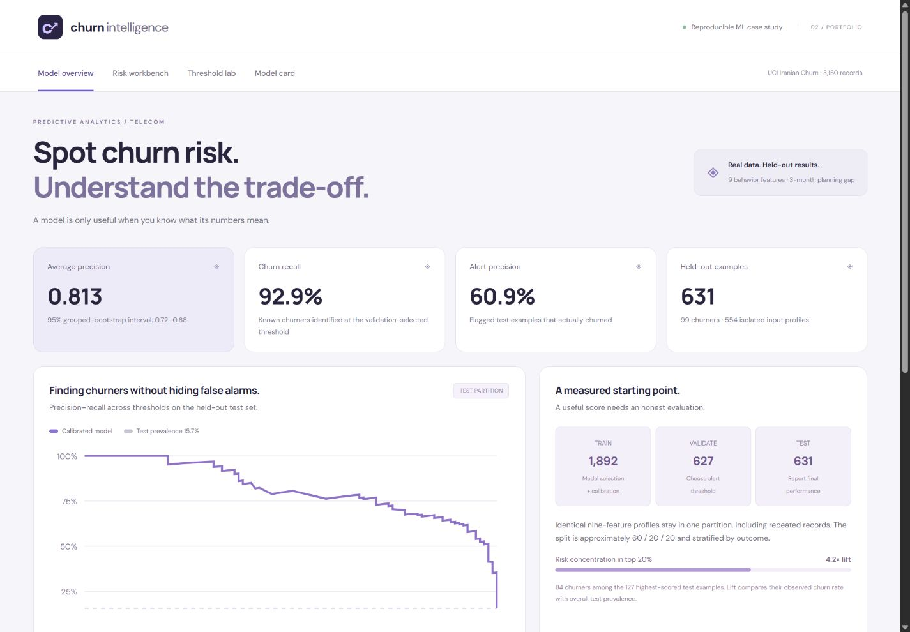
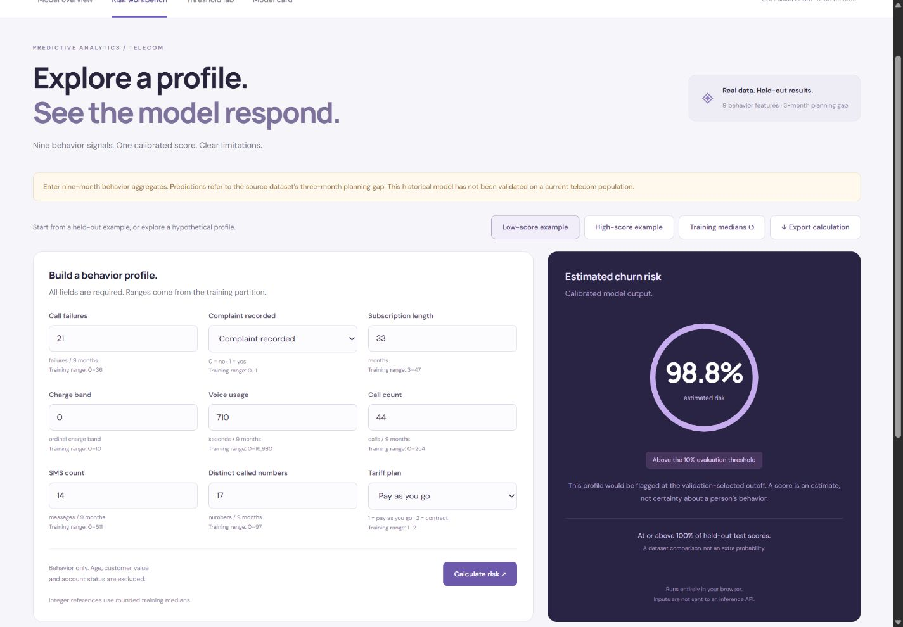
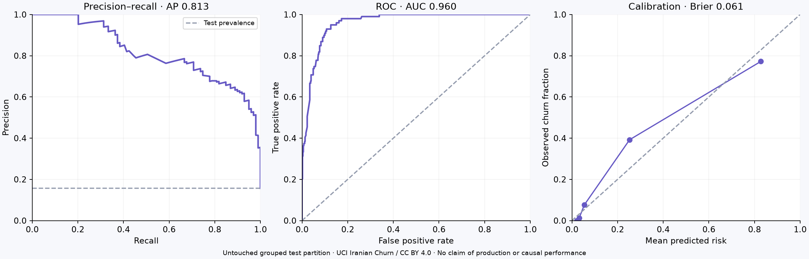

# Churn Intelligence

[](https://github.com/Boody700/churn-intelligence/actions/workflows/checks.yml)

**Calibrated churn prediction with grouped evaluation, threshold trade-offs and portable inference.**

[Case study](docs/case-study.md) · [Interview notes](docs/interview-guide.md) · [Validation workflow](.github/workflows/checks.yml)

A complete machine learning portfolio project: predict telecom churn, evaluate on an isolated test set, explore individual profiles and make the precision/recall trade-off visible.

The project includes a reproducible Python training pipeline, logistic-regression baselines, a calibrated random-forest model, group-isolated evaluation, a portable browser inference engine, an interactive application and documented limitations. All metrics come from the public UCI Iranian Churn dataset, not generated examples.

## Explore the app

- **Model overview:** held-out results, precision–recall curve, train/validation/test splits, baseline comparisons and permutation importance.
- **Risk workbench:** enter nine-month behavior aggregates, calculate a model score locally, and inspect one-feature-at-a-time sensitivity relative to training references.
- **Threshold lab:** change an alert cutoff; see confusion-matrix counts, recall, precision and a ranked queue of flagged test examples. Export that queue to CSV.
- **Model card:** intended use, dataset, feature exclusions, calibration, uncertainty and limitations.

The refined workbench preserves blank inputs across navigation, exports the last calculated profile with its actual model score, and compares that score with the held-out score distribution. Model metadata is downloadable, charts have data-table alternatives, and near-zero sensitivities use an explicit empty state.

## Results

| Held-out test measure | Result |
|---|---:|
| Test records | 631 |
| Actual churners | 99 |
| Average precision | 0.813 |
| ROC AUC | 0.960 |
| Brier score | 0.061 |
| Validation-selected alert threshold | 0.10 |
| Churners identified | 92 of 99 (92.9% recall) |
| False alerts | 59 |
| Alert precision | 60.9% |

The AP 95% grouped-bootstrap interval is 0.720–0.881; ROC AUC interval is 0.943–0.975. These intervals are conditional on this trained model and split, not guarantees for other populations. Average precision and ROC AUC are **not classification accuracy**.







## Run the included app

Python 3.10+ is enough to serve the prebuilt static app; no ML package or external inference account is required for viewing.

```powershell
python scripts/serve.py
```

Open `http://127.0.0.1:4174`. On Windows, use `py` if your installation exposes the Python launcher rather than `python`. The app uses the actual exported calibrated model, not a lookup table or a hand-written risk formula.

## Reproduce the full project

Run from this project directory:

```powershell
python -m venv .venv
.venv\Scripts\python -m pip install -r requirements.txt
.venv\Scripts\python scripts/train.py
.venv\Scripts\python -m unittest discover -s tests -v
node tests/inference.test.cjs
.venv\Scripts\python scripts/serve.py
```

On macOS/Linux, replace `.venv\Scripts\python` with `.venv/bin/python`. Node.js 18+ is required only for the browser-engine checks. `requirements-lock.txt` records the package versions used for the verified Python 3.12 build; install it instead of the ranged requirements when recreating that environment.

The initial training run downloads the small original UCI archive. Subsequent runs reuse it. It regenerates the model, split manifest, metrics, portable inference JSON, browser payload, permutation importance and report chart. Raw data and the joblib model are excluded from the source archive; running training recreates them. Load joblib artifacts only from sources you trust.

## Why this evaluation is stronger than a random row split

The 3,150 rows contain 300 exactly repeated full rows and only 2,785 unique selected-feature profiles. With no customer identifiers, repeated profiles may represent different people, so they are retained. Identical nine-feature profiles always share a split group, preventing exact-profile leakage across training, calibration, validation and test.

The pipeline allocates 1,892 training rows, 627 validation rows and 631 test rows through stratified group folds. Four candidates are compared by three-fold grouped training average precision. The selected depth-10 random forest is sigmoid-calibrated on grouped training folds. Validation data chooses the F2-maximizing threshold; the test partition is scored afterwards.

## Feature policy

Nine model inputs: call failures, complaints, subscription length, ordinal charge band, voice seconds, call count, SMS count, distinct called numbers and tariff plan.

`Status` is omitted as a conservative account-state shortcut exclusion. `Customer Value` is omitted because its derivation is not fully documented in the source card. `Age` and `Age Group` are excluded from prediction. This does not establish demographic fairness; behavior may still be a proxy.

The source card describes charge bands 0–9, while seven observed records use band 10. Those observations are retained as an ordinal category; the workbench displays the actual training range. No price or monetary interpretation is invented. Integer reference inputs use rounded training medians.

## Structure

```text
scripts/train.py          Download, split, compare, calibrate, evaluate and export
scripts/serve.py          Local server; serves dist/ only
dist/inference.js         Portable calibrated forest/logistic inference
dist/app.js               Interactive workbench and evaluation app
dist/data.js              Model and measured evaluation payload
models/portable-model.json  Readable model parameters
data/metrics.json         Metric values, split counts, seed and source checksum
data/split-membership.csv Group-aware split manifest
reports/                  Curves, model comparison, importance and predictions
tests/                    Group integrity, parity, threshold and metric checks
docs/                     Case study, model card, validation and interview guide
```

## Limits

This is one historical telecom dataset. The source says features summarize the first nine months and churn labels describe status at month 12, with a three-month planning gap. There is no customer ID or timestamp for a longitudinal deployment-style split. Future-population calibration and performance are unverified. Sensitivity is model behavior, not a causal explanation. No retention uplift, campaign result or profit impact is claimed.

Read [the case study](docs/case-study.md), [model card](docs/model-card.md), [validation](docs/validation.md) and [interview guide](docs/interview-guide.md).

## Attribution and deployment

Iranian Churn [Dataset]. (2020). UCI Machine Learning Repository. https://doi.org/10.24432/C5JW3Z. Licensed CC BY 4.0. Data is normalized, partitioned and transformed into model parameters/evaluation outputs in this project. Project code uses the MIT license; dataset attribution remains required.

The complete prebuilt application runs locally using the commands above.


## Development

Independent educational portfolio project. The source, evaluation design and limitations are documented so the work can be inspected and reproduced. GitHub Actions runs the committed browser checks. Python pipeline reproduction uses the commands and data sources described above.
